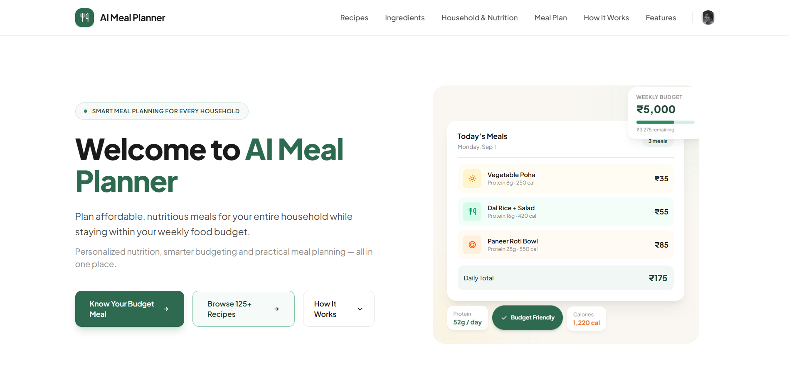
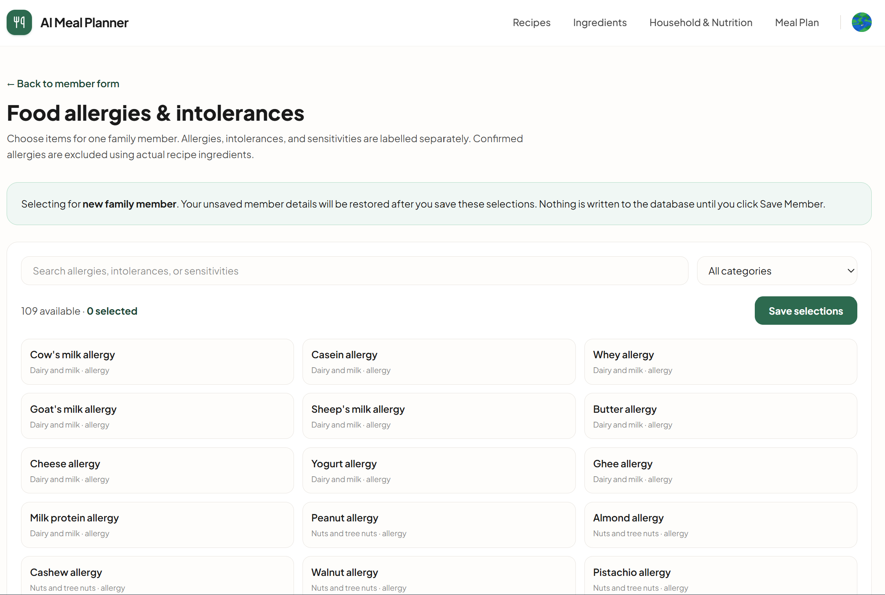
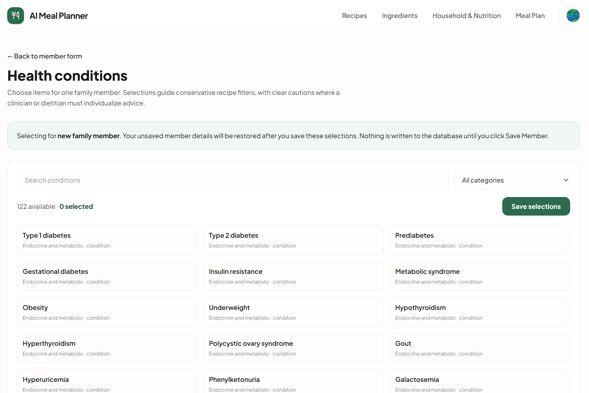
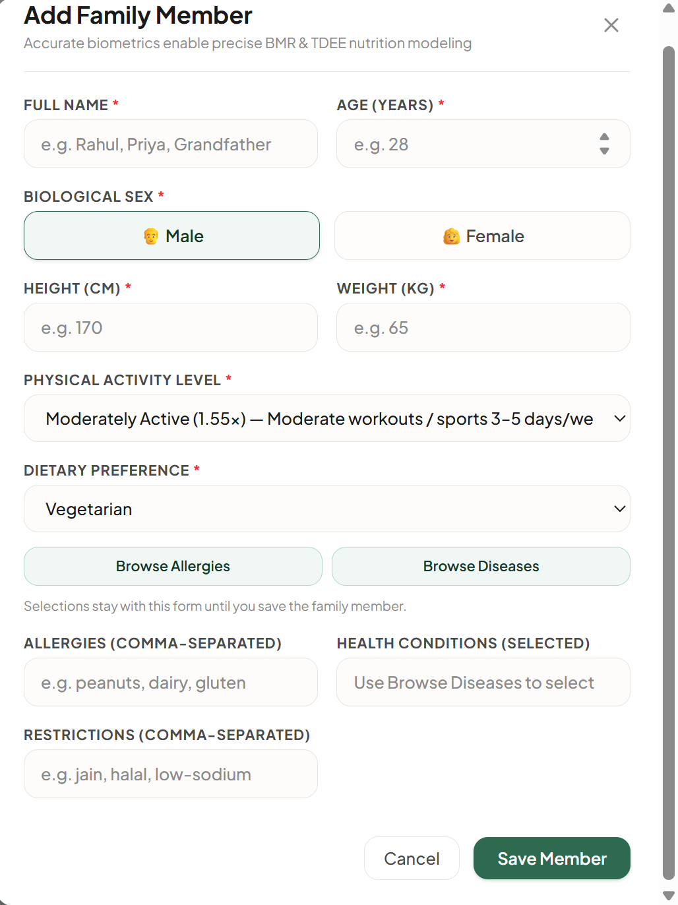

# aIMeal

**Automated, Nutrition-Aware Weekly Meal Planning for Multi-Member Households**

aIMeal is a full-stack application that generates personalized 7-day meal plans for entire households using Integer Linear Programming (ILP). It computes per-member Basal Metabolic Rate via the Mifflin-St Jeor equation, enforces allergen and medical condition safety constraints, and serves a RAG-grounded conversational assistant for nutrition queries.

---



---

## Table of Contents

- [Architecture Overview](#architecture-overview)
- [Tech Stack](#tech-stack)
- [Database Schema](#database-schema)
- [Nutrition Engine](#nutrition-engine)
- [ILP Meal Plan Optimizer](#ilp-meal-plan-optimizer)
- [Health Catalog and Safety System](#health-catalog-and-safety-system)
- [Explainability Engine](#explainability-engine)
- [Grocery Aggregation Service](#grocery-aggregation-service)
- [RAG Chatbot](#rag-chatbot)
- [Frontend Application](#frontend-application)
- [End-to-End User Flow](#end-to-end-user-flow)
- [Project Structure](#project-structure)
- [Setup and Installation](#setup-and-installation)
- [Environment Variables](#environment-variables)
- [Disclaimer](#disclaimer)

---

## Architecture Overview

```
+---------------------+       HTTPS/JSON        +---------------------+
|                     | -----------------------> |                     |
|   React 19 SPA      |                          |   FastAPI Backend   |
|   (Vite + Tailwind   | <---------------------- |                     |
|    CSS v4)           |       JSON Responses     +----------+----------+
|                     |                                     |
+----------+----------+                                     |
           |                                                |
     Clerk Auth                                  +----------v----------+
     (JWT RS256)                                 |   SQLAlchemy 2.0    |
                                                 |   + Alembic         |
                                                 +----------+----------+
                                                            |
                                                 +----------v----------+
                                                 |   PostgreSQL (Neon) |
                                                 +---------------------+

                          Backend Services
            +------------------------------------------+
            |                                          |
   +--------v--------+  +----------+  +---------------v---------+
   | Nutrition Engine |  |  Health  |  |    ILP Optimizer        |
   | (Mifflin-St     |  | Catalog  |  |    (PuLP/CBC Solver)    |
   |  Jeor + TDEE)   |  | + Safety |  |    28 Slots/Week       |
   +-----------------+  +----------+  +-------------------------+
            |                                          |
   +--------v--------+  +-----------+  +--------------v---------+
   | Explainability   |  | Grocery  |  |  RAG Chatbot           |
   | Engine           |  | Service  |  |  Groq LLM + Pinecone   |
   | (Template-Based) |  |          |  |  + MiniLM-L6-v2        |
   +-----------------+  +-----------+  +------------------------+
```

### Request Lifecycle

1. The React frontend authenticates users via Clerk (RS256 JWTs).
2. On sign-in, the frontend POSTs to `/api/me` to upsert the user record in PostgreSQL.
3. The backend verifies every request by fetching Clerk's JWKS endpoint and validating the JWT signature.
4. Domain routers (`household`, `food`, `meal_plan`, `chat`, `health`) delegate to service modules.
5. The ILP optimizer pulls household nutrition targets, recipes, and safety constraints, then solves a constrained optimization problem to produce the weekly plan.

---

## Tech Stack

### Frontend

| Component       | Technology                       |
|-----------------|----------------------------------|
| Framework       | React 19                         |
| Build Tool      | Vite                             |
| Styling         | Tailwind CSS v4 (`@tailwindcss/vite`) |
| Routing         | React Router v7                  |
| Authentication  | `@clerk/clerk-react`             |
| HTTP Client     | Axios                            |

### Backend

| Component        | Technology                            |
|------------------|---------------------------------------|
| Framework        | FastAPI                               |
| ORM              | SQLAlchemy 2.0                        |
| Migrations       | Alembic                               |
| Database         | PostgreSQL (Neon serverless)          |
| ILP Solver       | PuLP (CBC backend)                    |
| LLM              | Groq (`openai/gpt-oss-120b`)         |
| Embeddings       | `sentence-transformers` (all-MiniLM-L6-v2) |
| Vector Store     | Pinecone                              |
| Auth Verification| python-jose (RS256 JWKS)              |
| Testing          | pytest                                |

---

## Database Schema

```
users
  +-- id (PK)
  +-- clerk_id (unique)
  +-- email
  +-- first_name, last_name
  +-- created_at, updated_at

households
  +-- id (PK)
  +-- user_id (FK -> users.id)
  +-- name
  +-- created_at, updated_at
      |
      +-- members
      |     +-- id (PK)
      |     +-- household_id (FK)
      |     +-- name, age, gender, weight_kg, height_cm
      |     +-- activity_level (enum: sedentary|light|moderate|active|very_active)
      |     +-- dietary_preference (enum: veg|non-veg|vegan|eggetarian)
      |     +-- allergies (JSON array)
      |     +-- diseases (JSON array)
      |     +-- is_primary
      |     +-- created_at, updated_at
      |           |
      |           +-- nutrition_targets
      |                 +-- id (PK)
      |                 +-- member_id (FK)
      |                 +-- calories, protein_g, carbs_g, fat_g, fiber_g
      |                 +-- salt_limit_g (nullable, condition-driven)
      |                 +-- clinician_review (boolean)
      |                 +-- created_at, updated_at
      |
      +-- meal_plans
            +-- id (PK)
            +-- household_id (FK)
            +-- week_start_date
            +-- status (enum: active|archived|needs_regeneration)
            +-- created_at
                  |
                  +-- meals
                        +-- id (PK)
                        +-- meal_plan_id (FK)
                        +-- recipe_id (FK -> recipes.id)
                        +-- day_of_week (0-6)
                        +-- meal_type (breakfast|lunch|dinner|snack)
                        +-- explanation (text)
                        +-- created_at

ingredients
  +-- id (PK)
  +-- name, category
  +-- calories, protein, carbs, fat, fiber (per 100g)
  +-- is_vegetarian, is_vegan, is_eggetarian

recipes
  +-- id (PK)
  +-- name, category (breakfast|lunch|dinner|snack)
  +-- cuisine_type, prep_time_minutes
  +-- total_calories, total_protein, total_carbs, total_fat, total_fiber
  +-- is_vegetarian, is_vegan, is_eggetarian
  +-- allergens (JSON array)
  +-- unsuitable_conditions (JSON array)
  +-- created_at
      |
      +-- recipe_ingredients
            +-- id (PK)
            +-- recipe_id (FK)
            +-- ingredient_id (FK)
            +-- quantity_grams
```

The seed database ships with a catalog of **150+ ingredients** and **200+ recipes** with pre-computed nutritional breakdowns, allergen tags, and condition-unsuitability flags.

---

## Nutrition Engine

Located in `backend/app/services/nutrition_service.py`.

### Basal Metabolic Rate (Mifflin-St Jeor)

$$
\text{BMR}_{\text{male}} = 10w + 6.25h - 5a + 5
$$

$$
\text{BMR}_{\text{female}} = 10w + 6.25h - 5a - 161
$$

Where $w$ = weight in kg, $h$ = height in cm, $a$ = age in years.

### Total Daily Energy Expenditure

$$
\text{TDEE} = \text{BMR} \times \text{Activity Multiplier}
$$

| Activity Level | Multiplier |
|----------------|------------|
| Sedentary      | 1.200      |
| Light          | 1.375      |
| Moderate       | 1.550      |
| Active         | 1.725      |
| Very Active    | 1.900      |

### Macronutrient Distribution

| Macro   | Share of TDEE |
|---------|---------------|
| Protein | 20%           |
| Carbs   | 50%           |
| Fat     | 30%           |

Fiber target: **14 g per 1,000 kcal** of TDEE.

### Condition-Based Adjustments

| Condition                          | Adjustment                         |
|------------------------------------|------------------------------------|
| Type 2 Diabetes / Prediabetes      | Carbs multiplied by 0.85           |
| High Triglycerides                 | Carbs multiplied by 0.85           |
| High Cholesterol                   | Fat multiplied by 0.85             |
| Hypertension                       | Salt capped at 3 g/day             |
| High-acuity conditions (multiple)  | `clinician_review` flag set `true` |


---

## ILP Meal Plan Optimizer

Located in `backend/app/services/optimizer.py` (518 lines).

The optimizer formulates a **Mixed-Integer Linear Program** solved by PuLP's CBC backend to assign recipes to a 28-slot weekly grid (7 days x 4 meal types: breakfast, lunch, dinner, snack).

### Decision Variables

For each recipe $r$ and each slot $(d, t)$ where $d \in \{0..6\}$ (day) and $t \in \{\text{breakfast, lunch, dinner, snack}\}$:

$$
x_{r,d,t} \in \{0, 1\}
$$

### Objective Function

Minimize the total absolute deviation of the household's aggregated daily nutrition from each member's scaled targets:

$$
\min \sum_{d} \sum_{n \in \{\text{cal, protein, carbs, fat, fiber}\}} \left| \sum_{t} \sum_{r} x_{r,d,t} \cdot n_r - T_{n,d} \right|
$$

Where $T_{n,d}$ is the household-level daily target for nutrient $n$ on day $d$ and $n_r$ is the nutrient content of recipe $r$.

A `MAIN_MEAL_SHARE` factor of **0.65** scales targets for main meals, distributing the remainder to snacks.

### Constraints

1. **Exactly one recipe per slot**: For each $(d, t)$: $\sum_r x_{r,d,t} = 1$
2. **Category matching**: Recipes assigned only to their tagged meal type.
3. **Dietary filtering**: Recipes filtered against household members' dietary preferences (veg, non-veg, vegan, eggetarian).
4. **Allergen exclusion**: Recipes whose `allergens` array intersects any member's allergy list are excluded.
5. **Condition exclusion**: Recipes flagged `unsuitable_conditions` matching any member's disease list are excluded.
6. **Weekly variety cap**: Breakfast and lunch recipes appear at most 1 time per week; dinner recipes at most 2 times.
7. **Consecutive-day ban**: The same recipe cannot appear on adjacent days for the same meal type.

### Four-Tier Relaxation Ladder

When the solver cannot find a feasible solution under full constraints, it progressively relaxes:

| Tier | Relaxation                                       |
|------|--------------------------------------------------|
| 1    | Full constraints (default)                       |
| 2    | Remove variety caps                              |
| 3    | Remove variety caps + consecutive-day ban        |
| 4    | Remove all variety constraints + widen nutrition tolerance |

### Per-Member Personalized Substitutions

After the household-level solve, the optimizer performs a **second pass** for each member who has allergies or medical conditions. For any meal that contains a flagged recipe, the service swaps in the closest nutritionally-compatible alternative from the eligible recipe pool. These substitutions are stored alongside the household plan and surfaced in the UI as personalized sections.


---

## Health Catalog and Safety System

Located in `backend/app/services/health_catalog.py` (149 lines) and `backend/app/services/compatibility_service.py`.

### Allergy Catalog

The system maintains a catalog of **50+ allergies** with associated ingredient-term mappings. Each allergy entry maps to a list of ingredient substrings used for exclusion matching. For example:

- `Gluten` maps to terms: `wheat`, `barley`, `rye`, `semolina`, `bulgur`, `couscous`, `seitan`, `maida`
- `Tree Nuts` maps to: `almond`, `cashew`, `walnut`, `pistachio`, `pecan`, `hazelnut`, `macadamia`, `brazil nut`, `pine nut`

### Condition Catalog

**50+ medical conditions** with:

- **Condition rules**: Nutrient-level adjustments applied during nutrition target computation (carb reduction, fat reduction, salt caps).
- **Ingredient-term exclusions**: Direct ingredient blocking (e.g., GERD excludes `spicy`, `chili`, `vinegar`; Celiac excludes all gluten-containing grains).

### Compatibility Check Pipeline

`compatibility_service.py` runs a pre-filter before the optimizer:

1. Collects all allergy terms and condition terms across household members.
2. Scans each recipe's ingredient list for substring matches against blocked terms.
3. Checks each recipe's `unsuitable_conditions` metadata.
4. Returns the filtered-safe recipe pool to the optimizer.







---

## Explainability Engine

Located in `backend/app/services/explainability_service.py`.

After the optimizer assigns a recipe to a slot, the explainability engine generates a **deterministic, template-based** natural language explanation for the assignment. Explanations reference:

- The recipe's macronutrient profile relative to the member's targets.
- Why this recipe was selected over alternatives (nutritional fit).
- Any relevant dietary or health context.

These explanations are stored in the `meals.explanation` column and displayed alongside each meal card in the frontend.

---

## Grocery Aggregation Service

Located in `backend/app/services/grocery_service.py`.

Given a generated meal plan, the grocery service:

1. Iterates over all 28 meals in the plan.
2. Collects each meal's recipe ingredients via the `recipe_ingredients` join table.
3. Aggregates quantities by ingredient, summing `quantity_grams` across all recipe uses.
4. Returns a consolidated grocery list grouped by ingredient category.

The frontend renders this as a checklist-style view on the `/grocery-list` route.

---

## RAG Chatbot

The Retrieval-Augmented Generation (RAG) chatbot provides a conversational interface grounded in both live household data and the project's own source code and documentation.

### Embedding and Indexing Pipeline

Located in `backend/app/rag/`.

| Component          | File                    | Purpose                                            |
|--------------------|-------------------------|----------------------------------------------------|
| Source Loader       | `source_loader.py`      | Discovers Python, JSX, and Markdown files from the project tree |
| Code Chunker        | `code_chunker.py`       | AST-based chunking for Python; regex-based for JSX and Markdown |
| Embedding Service   | `embedding_service.py`  | Generates 384-dimensional embeddings via `all-MiniLM-L6-v2`     |
| Pinecone Service    | `pinecone_service.py`   | Upserts and queries vectors in Pinecone index       |
| Ingestion Pipeline  | `ingestion.py`          | Incremental pipeline: hash-checks files, chunks, embeds, upserts |
| Retrieval           | `retrieval.py`          | Vector similarity search with score-threshold filtering |

### Chat Service

Located in `backend/app/services/chat_service.py` (389 lines).

The chat service uses **dual-grounded prompting**:

1. **Live Household Context**: Current members, their nutrition targets, active meal plan, and health profiles are serialized and injected into the system prompt.
2. **RAG Context**: The user's query is embedded, top-k similar chunks are retrieved from Pinecone, and qualifying chunks (above the similarity threshold) are appended to the prompt.

The grounded prompt is sent to **Groq** using the `openai/gpt-oss-120b` model. The response is streamed back to the frontend via the `/api/chat` endpoint.

### Chat Router

`POST /api/chat` accepts `{ "message": string, "household_id": integer }` and returns the LLM response with household-aware, documentation-grounded answers.


---

## Frontend Application

### Route Map

| Route            | Page Component        | Description                                    |
|------------------|-----------------------|------------------------------------------------|
| `/`              | `Landing.jsx`         | Hero section, feature cards, how-it-works flow |
| `/household`     | `Household.jsx`       | Household CRUD, member management              |
| `/meal-plan`     | `MealPlan.jsx`        | Generate and view weekly meal plan grid        |
| `/grocery-list`  | `GroceryList.jsx`     | Aggregated grocery checklist                   |
| `/recipes`       | `Recipes.jsx`         | Browse and filter recipe catalog               |
| `/ingredients`   | `Ingredients.jsx`     | Browse ingredient catalog                      |
| `/allergies`     | `HealthSelection.jsx` | Allergy selection for member draft             |
| `/diseases`      | `HealthSelection.jsx` | Disease selection for member draft             |
| `/login`         | `Login.jsx`           | Clerk sign-in                                  |
| `/register`      | `Register.jsx`        | Clerk sign-up                                  |

### Key UI Components

**Household Management** (`Household.jsx` -- 877 lines): Full member CRUD with inline modals for adding/editing members. Each member card displays computed nutrition targets (calories, protein, carbs, fat, fiber) with progress indicators. Supports the `MemberDraftContext` for preserving in-progress form state during navigation to allergy/disease selection pages.


**Meal Plan Grid** (`MealPlanGrid.jsx`): 7-column by 4-row grid (Monday through Sunday, Breakfast through Snack). Each cell renders a `MealCard` with recipe name, calorie count, and an expand action to view the full explanation.


**Meal Swap Modal** (`SwapMealModal.jsx` -- 276 lines): Allows users to swap a specific meal slot with an alternative recipe. The modal displays compatible alternatives filtered through the same allergen, condition, and dietary constraints as the original solve. On swap, the backend updates the meal record and regenerates the explanation.


**Recipe Explorer** (`Recipes.jsx` -- 386 lines): Searchable, filterable catalog of all recipes in the database. Supports filtering by category (breakfast, lunch, dinner, snack), cuisine type, and dietary tags. Each recipe card expands into a `RecipeModal` showing full ingredient breakdown and nutritional values.


**Ingredients Catalog** (`Ingredients.jsx`): Tabular listing of all ingredients with per-100g nutritional data. Supports text search and category filtering.


**Chat Widget** (`ChatWidget.jsx`): Floating chat bubble that opens `ChatWindow.jsx`. Includes `QuickQuestions.jsx` with preset query suggestions. Messages render via `ChatMessage.jsx` with markdown support.

**User Profile** (`Navbar.jsx`): Clerk `UserButton` component with avatar and sign-out. Navigation bar links to all primary routes.



### State Management

- **MemberDraftContext** (`context/MemberDraftContext.jsx`): Uses `sessionStorage` to persist in-progress member form data (name, age, weight, allergies, diseases) when the user navigates away to the `/allergies` or `/diseases` selection pages and returns. Prevents data loss during multi-step member creation.

- **Meal Plan Status**: The backend tracks `needs_regeneration` status on meal plans. When a household's member profile changes (allergies, conditions, dietary preferences), the active meal plan is flagged, and the frontend prompts the user to regenerate.

---

## End-to-End User Flow

```
  [1. Sign Up / Sign In]
          |
          v
  [2. Create Household]
          |
          v
  [3. Add Members] --> [3a. Set Demographics] --> [3b. Select Allergies]
          |                                              |
          |                                    [3c. Select Diseases]
          |                                              |
          v                                              v
  [4. Nutrition Targets Auto-Computed] <-----------------+
          |
          |  Mifflin-St Jeor BMR --> TDEE --> Macro Split
          |  Condition adjustments applied
          |
          v
  [5. Generate Meal Plan]
          |
          |  ILP optimizer solves 28-slot grid
          |  Allergen + condition safety enforced
          |  Per-member substitutions computed
          |  Explanations generated
          |
          v
  [6. View Weekly Plan] --> [6a. Swap Individual Meals]
          |
          v
  [7. View Grocery List]
          |
          v
  [8. Chat with RAG Assistant]
          |
          |  Household context + vector-retrieved docs
          |  grounded through Groq LLM
          |
          v
  [9. Modify Household] --> triggers needs_regeneration --> [5]
```

---

## Project Structure

```
aIMeal/
|-- backend/
|   |-- app/
|   |   |-- main.py                     # FastAPI entry, CORS, router registration
|   |   |-- core/
|   |   |   |-- auth.py                 # Clerk JWKS JWT verification
|   |   |   |-- database.py            # SQLAlchemy engine + session factory
|   |   |-- models/
|   |   |   |-- user.py                # User model (clerk_id, email)
|   |   |   |-- household.py           # Household model
|   |   |   |-- member.py              # Member model (demographics, allergies, diseases)
|   |   |   |-- nutrition.py           # NutritionTarget model
|   |   |   |-- ingredient.py          # Ingredient model (per-100g nutrients)
|   |   |   |-- recipe.py              # Recipe + RecipeIngredient models
|   |   |   |-- meal_plan.py           # MealPlan model (status enum)
|   |   |   |-- meal.py                # Meal model (slot assignment + explanation)
|   |   |-- routers/
|   |   |   |-- household.py           # Household + member CRUD, nutrition endpoints
|   |   |   |-- food.py                # Ingredient + recipe read-only catalog
|   |   |   |-- meal_plan.py           # Generate, list, get, swap, grocery endpoints
|   |   |   |-- chat.py                # RAG chatbot endpoint
|   |   |   |-- health.py              # Allergy + disease catalog endpoint
|   |   |-- schemas/
|   |   |   |-- household.py           # Pydantic request/response schemas
|   |   |   |-- nutrition.py           # Nutrition target schemas
|   |   |   |-- chat.py                # Chat request/response schemas
|   |   |-- services/
|   |   |   |-- nutrition_service.py   # BMR, TDEE, macro computation
|   |   |   |-- optimizer.py           # PuLP ILP solver (518 lines)
|   |   |   |-- explainability_service.py  # Template-based meal explanations
|   |   |   |-- grocery_service.py     # Ingredient aggregation
|   |   |   |-- chat_service.py        # Dual-grounded Groq LLM chat (389 lines)
|   |   |   |-- compatibility_service.py   # Allergen + condition safety filter
|   |   |   |-- health_catalog.py      # 50+ allergies, 50+ conditions, term mappings
|   |   |   |-- embedding_service.py   # MiniLM-L6-v2 sentence embeddings
|   |   |   |-- pinecone_service.py    # Pinecone vector DB client
|   |   |-- rag/
|   |   |   |-- source_loader.py       # File discovery for ingestion
|   |   |   |-- code_chunker.py        # AST + regex chunking
|   |   |   |-- ingestion.py           # Incremental embed + upsert pipeline
|   |   |   |-- retrieval.py           # Vector search + threshold filtering
|   |   |-- seed/
|   |       |-- seed_database.py       # Database seeding script
|   |       |-- ingredients.py         # 150+ ingredient definitions (941 lines)
|   |       |-- recipes.py             # 200+ recipe definitions (2550 lines)
|   |-- tests/
|   |   |-- test_chat.py
|   |   |-- test_household.py
|   |   |-- test_rag.py
|   |-- docs/
|   |   |-- FOOD_DATABASE.md
|   |   |-- NUTRITION_ENGINE.md
|   |   |-- RAG_ARCHITECTURE.md
|   |   |-- RAG_SETUP.md
|   |-- requirements.txt
|   |-- .env.example
|   |-- alembic/                       # Database migration scripts
|
|-- frontend/
|   |-- src/
|   |   |-- main.jsx                   # ClerkProvider + App mount
|   |   |-- App.jsx                    # Route definitions + user sync
|   |   |-- context/
|   |   |   |-- MemberDraftContext.jsx  # sessionStorage draft persistence
|   |   |-- pages/
|   |   |   |-- Landing.jsx            # Hero + features + how-it-works
|   |   |   |-- Household.jsx          # Member management (877 lines)
|   |   |   |-- MealPlan.jsx           # Plan generation + grid view
|   |   |   |-- GroceryList.jsx        # Aggregated grocery checklist
|   |   |   |-- Recipes.jsx            # Recipe catalog + filters
|   |   |   |-- Ingredients.jsx        # Ingredient catalog
|   |   |   |-- HealthSelection.jsx    # Allergy/disease selection grid
|   |   |   |-- Login.jsx              # Clerk sign-in page
|   |   |   |-- Register.jsx           # Clerk sign-up page
|   |   |-- components/
|   |       |-- Navbar.jsx             # Navigation + Clerk UserButton
|   |       |-- Footer.jsx
|   |       |-- MealPlanGrid.jsx       # 7x4 weekly grid renderer
|   |       |-- SwapMealModal.jsx      # Meal swap with constraint filtering
|   |       |-- MealCard.jsx           # Individual meal cell
|   |       |-- ChatWidget.jsx         # Floating chat launcher
|   |       |-- ChatWindow.jsx         # Chat conversation view
|   |       |-- ChatMessage.jsx        # Message bubble renderer
|   |       |-- QuickQuestions.jsx     # Preset query suggestions
|   |       |-- HouseholdModal.jsx     # Household create/edit modal
|   |       |-- MemberModal.jsx        # Member create/edit modal
|   |       |-- MetabolicModal.jsx     # Nutrition target detail modal
|   |       |-- RecipeModal.jsx        # Recipe detail modal
|   |       |-- FeatureCard.jsx        # Landing page feature card
|   |       |-- HeroVisual.jsx         # Landing page hero graphic
|   |       |-- HowItWorksStep.jsx     # Landing page step card
|   |-- package.json
|   |-- vite.config.js
|
|-- assets/                            # Documentation screenshots
```

---

## Setup and Installation

### Prerequisites

- Python 3.10+
- Node.js 18+
- PostgreSQL instance (or Neon serverless account)
- Clerk account (for authentication)
- Pinecone account (for RAG vector storage)
- Groq API key (for LLM inference)

### Backend

```bash
cd backend

# Create and activate virtual environment
python -m venv .venv
source .venv/bin/activate        # Linux/macOS
.venv\Scripts\activate           # Windows

# Install dependencies
pip install -r requirements.txt

# Configure environment
cp .env.example .env
# Edit .env with your credentials (see Environment Variables section)

# Run database migrations
alembic upgrade head

# Seed the database with ingredients and recipes
python -m app.seed.seed_database

# (Optional) Run RAG ingestion pipeline
python -m app.rag.ingestion

# Start the development server
uvicorn app.main:app --reload --port 8000
```

### Frontend

```bash
cd frontend

# Install dependencies
npm install

# Start the development server
npm run dev
```

The frontend runs on `http://localhost:5173` by default and proxies API requests to the backend on port 8000.

---

## Environment Variables

The backend expects the following variables in `backend/.env`:

| Variable              | Description                                     |
|-----------------------|-------------------------------------------------|
| `DATABASE_URL`        | PostgreSQL connection string (Neon)              |
| `CLERK_JWKS_URL`      | Clerk JWKS endpoint for JWT verification         |
| `GROQ_API_KEY`        | Groq API key for LLM inference                   |
| `PINECONE_API_KEY`    | Pinecone API key for vector storage              |
| `PINECONE_INDEX_NAME` | Pinecone index name                              |

The frontend expects:

| Variable                    | Description                      |
|-----------------------------|----------------------------------|
| `VITE_CLERK_PUBLISHABLE_KEY` | Clerk publishable key            |
| `VITE_API_BASE_URL`          | Backend API base URL             |

---

## Disclaimer

aIMeal is an academic and engineering demonstration project. The nutrition computations, meal plan optimizations, and health-related logic are implemented for educational purposes. This application does not constitute medical or dietary advice. The `clinician_review` flag is set programmatically for high-acuity conditions but does not replace consultation with a qualified healthcare professional. Users with medical conditions should consult their physician or a registered dietitian before acting on any output from this system.
